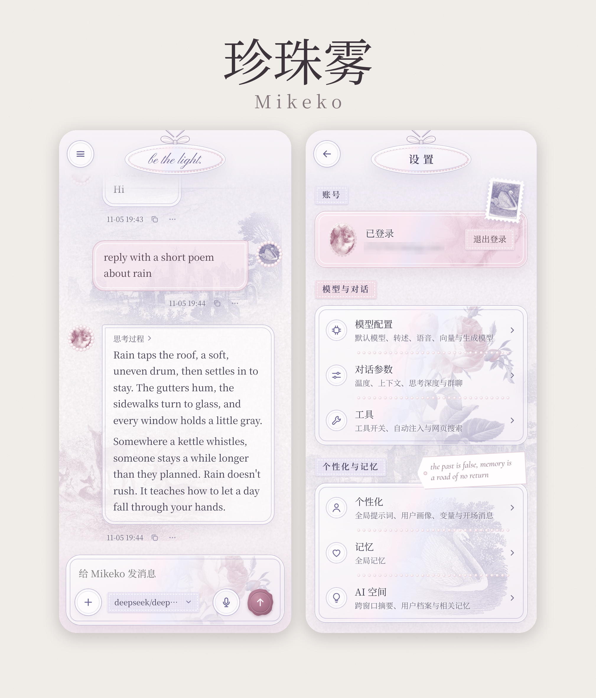
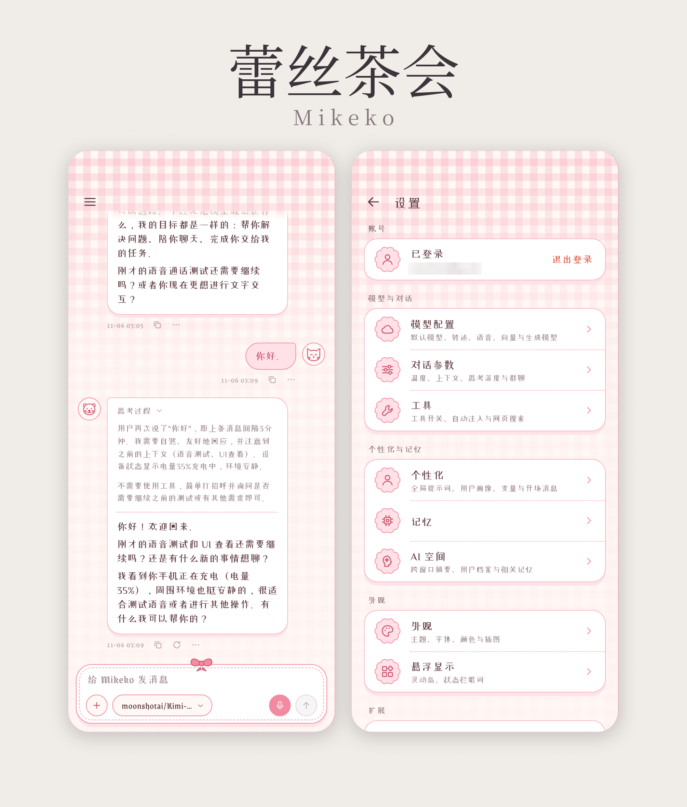
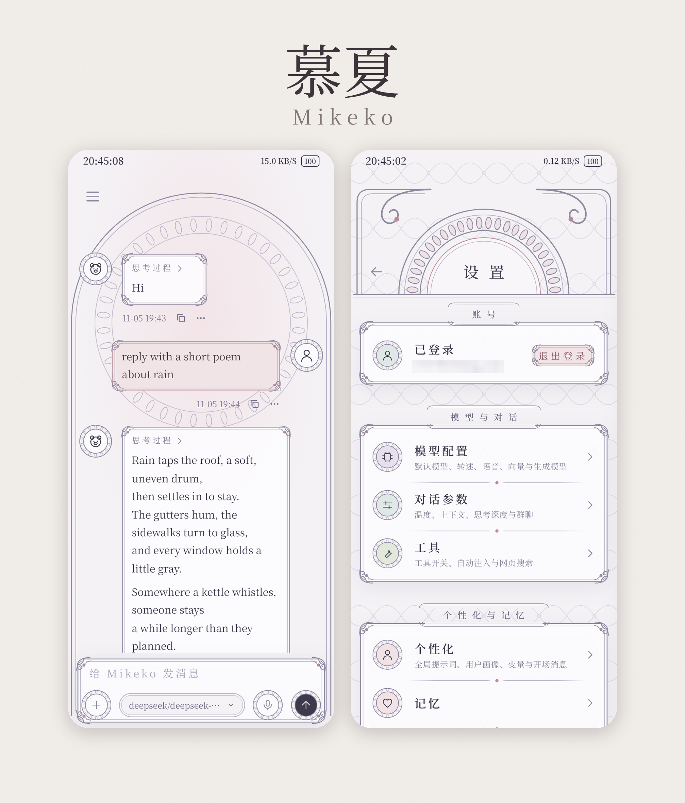
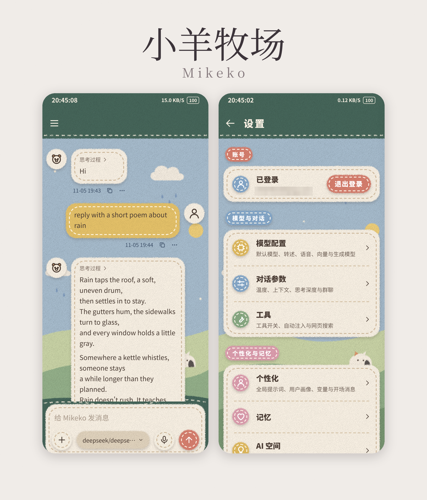
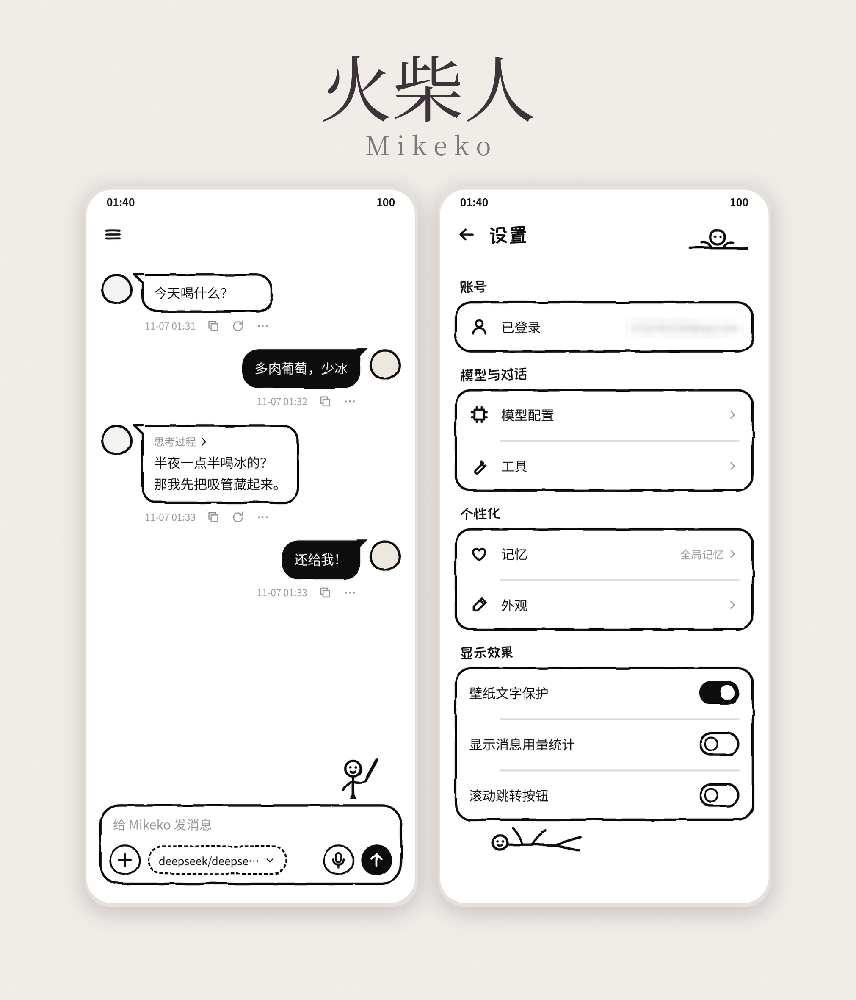
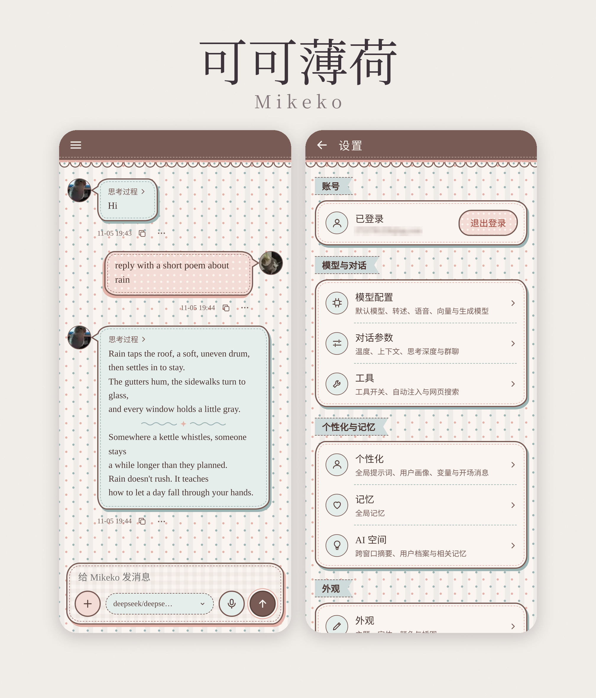
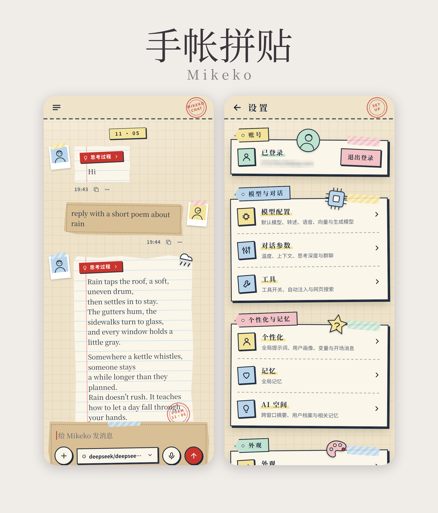
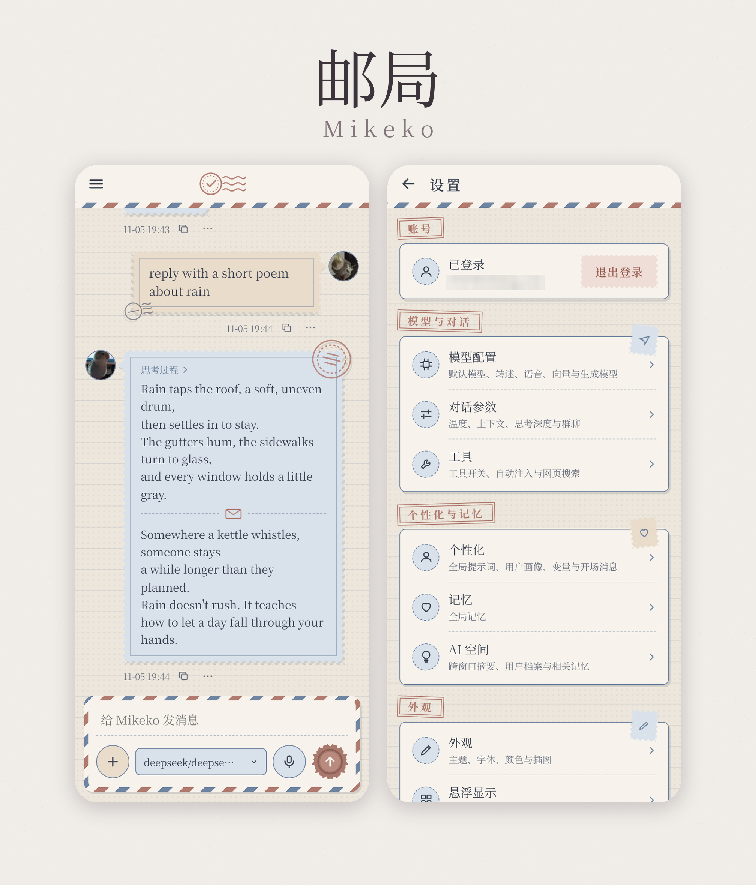
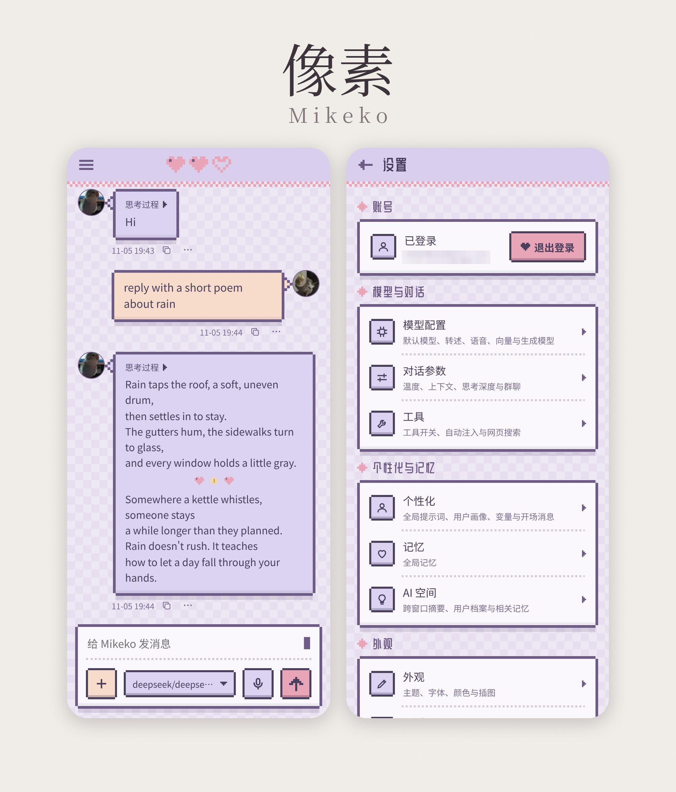
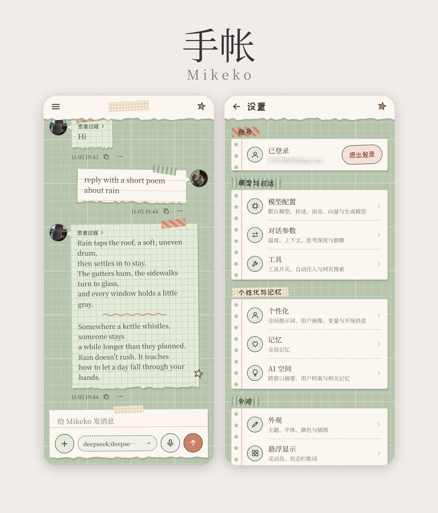

# mikeko-skins

这是我给 Mikeko 做的一堆皮肤稿，都是 HTML，下载下来用浏览器打开就能看，不用装任何东西。

每一套都是我自己想的风格，让 AI 画成页面（大部分是 Claude，慕夏是 Hark），我再一版一版挑毛病、打回去改，改到我满意为止。所以代码挺简陋的，就是稿子，不是能直接跑的 App。想拿去改着玩随便改，丢给你的 AI 让它照着调就行。

大部分皮肤的字体是在线加载的，第一次打开要联网，不然字会变成系统默认的，样子差一截。

## 有哪些

| 皮肤 | 预览 | 打开 |
|---|---|---|
| 珍珠雾 |  | `pearl-mist/chat.html`、`settings.html` |
| 蕾丝茶会 |  | `lace-tea-party/蕾丝茶会.html` |
| 慕夏 |  | `mucha/慕夏.html` |
| 小羊牧场 |  | `sheep-meadow/毛毡.html` |
| 火柴人 |  | `matchstick/喜茶极简.html` |
| 可可薄荷 |  | `cocoa-mint/聊天.html`、`设置.html`、`配色.html` |
| 手帐拼贴 |  | `journal-collage/聊天.html`、`设置.html` |
| 邮局 |  | `post-office/聊天.html`、`设置.html` |
| 像素 |  | `pixel/聊天.html`、`设置.html` |
| 手帐 |  | `journal/聊天.html`、`设置.html` |

- 可可薄荷里的 `画布源文件/` 少一个 `support.js`，单独打开会缺东西，看聊天和设置页就好。
- 手帐拼贴的 `样式规范.md` 里有它的配色、字体、尺寸，想照着做可以看这个。
- 邮局里的两个头像是我自己的头像。

## 图和字体

页面里的图标、贴纸、印章这些都是跟着稿子一起画的。

珍珠雾里那几张古典插画是公共领域的老版画，我染成紫色裁了一下：

- 天鹅：Thomas Bewick，《A History of British Birds》（1804），[Wikimedia Commons](https://commons.wikimedia.org/wiki/File:Thomas_Bewick_-_%22The_Mute_Swan%22_or_%22Tame_Swan%22_-_B1994.4.673_-_Yale_Center_for_British_Art.jpg)
- 小天使：Ercole Procaccini the Younger，"Putto"，[大都会博物馆](https://www.metmuseum.org/art/collection/search/340149)
- 玫瑰：Redouté，《Les Roses》，[Wikimedia Commons](https://commons.wikimedia.org/wiki/File:Redoute_-_Rosa_centifolia_foliacea.jpg)
- 小鹿、城堡、纸纹：也是从芝加哥艺术博物馆、大都会、Wikimedia Commons 的公共领域馆藏里挑的

字体都是开源的（SIL OFL 1.1）：珍珠雾的 Cormorant Garamond 和 Pinyon Script 随仓库附带，许可在 `pearl-mist/fonts/`；蕾丝茶会的站酷小薇、Grenze Gotisch、UnifrakturMaguntia 直接嵌在页面里，许可在 `lace-tea-party/licenses/`；其他几套用的是 Noto、站酷快乐体、站酷庆科黄油体，从 Google Fonts 在线加载。
